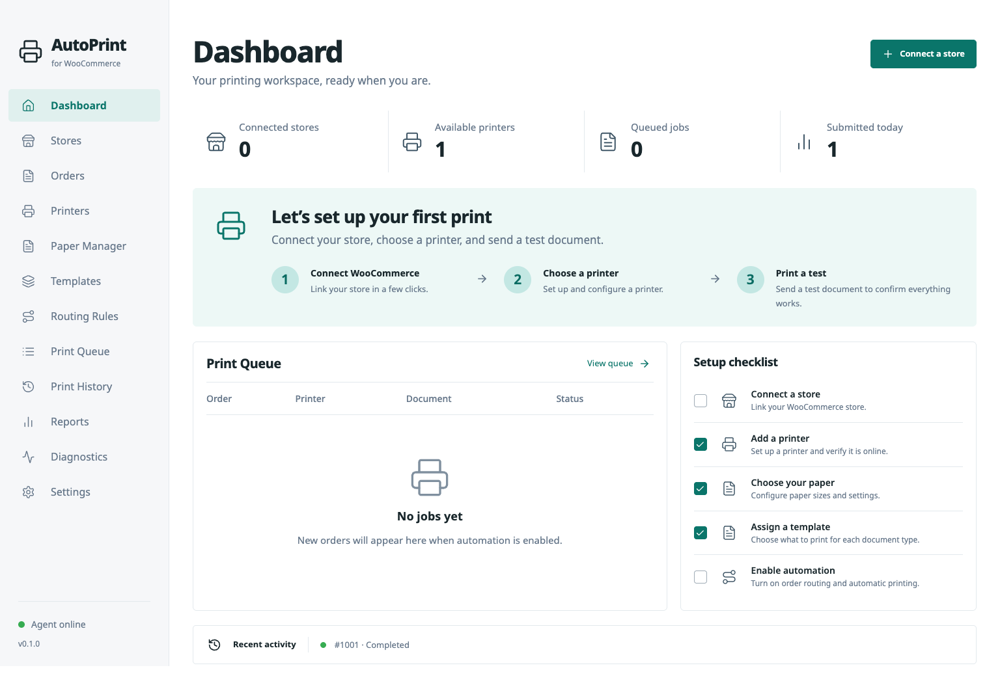
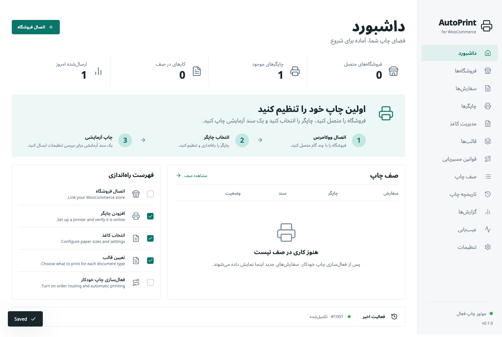
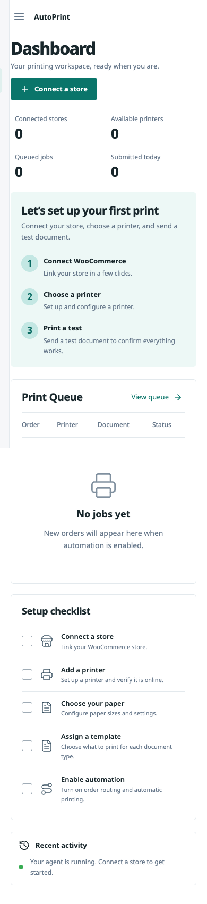
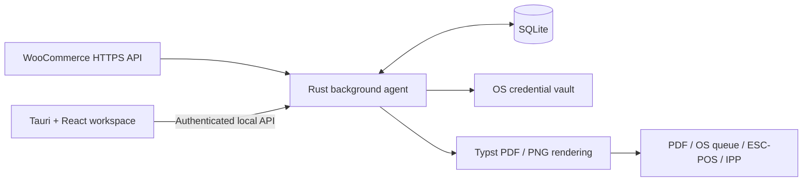

# WooCommerce AutoPrint

**A desktop workspace and independent background engine for WooCommerce order printing.**

Connect stores, configure printers and paper, design documents, and route eligible orders into a durable print queue. A Rust agent handles synchronization, rendering, and print submission; the Tauri 2 and React interface provides configuration and monitoring. The agent continues processing when the application window closes.

[Quick start](#quick-start) · [User guide](docs/USER_GUIDE.md) · [Architecture](docs/ARCHITECTURE.md) · [Implementation status](docs/IMPLEMENTATION_STATUS.md)

> **Project status:** Functional initial implementation with a verified macOS arm64 review build. The full specification remains incomplete, and the application is **not production-ready**. Windows/Linux native builds, live-store integration, and physical printer behavior require validation. See [known limitations](docs/KNOWN_LIMITATIONS.md) and the [requirement matrix](docs/REQUIREMENT_MATRIX.md).

## Screenshots

These captures show the running application interface in an isolated verification workspace. Displayed activity uses fictional test records. Browser captures omit native window chrome.

### Dashboard



The dashboard brings configuration progress, agent connectivity, queue state, and recent activity into one workspace.

<details>
<summary><strong>Persian interface and right-to-left layout</strong></summary>



Persian and Arabic interface modes use a right-to-left layout. Non-English translations are partial; missing strings fall back to English, and coverage is disclosed in Settings.

</details>

<details>
<summary><strong>Responsive layout at a narrow browser viewport</strong></summary>



The workspace adapts to a narrow viewport with stacked content and compact navigation. This capture demonstrates responsive behavior in the browser development interface.

</details>

See [visual verification](docs/VISUAL_REVIEW.md) for capture conditions and review notes.

## Current capabilities

| Area                  | Implemented behavior                                                                                                                                                        |
| --------------------- | --------------------------------------------------------------------------------------------------------------------------------------------------------------------------- |
| Store synchronization | Multiple store configurations, HTTPS WooCommerce polling, paginated reconciliation, overlap checkpoints, and credentials stored in the OS vault.                            |
| Background processing | An independent agent, exclusive data-directory lock, authenticated local API, SQLite-backed queue, immutable job snapshots, bounded retries, and crash recovery.            |
| Document templates    | 13 built-in templates, separate draft and published versions, a flow-based visual editor, bindings and conditions, safe JSON import/export, and generated PDF/PNG previews. |
| Paper geometry        | 19 paper presets, custom dimensions in mm/cm/in, margins, orientation, position offsets, and actual-size output using canonical physical units.                             |
| Print destinations    | PDF output, OS printer discovery and submission, compatible ESC/POS TCP raster output, and a preliminary direct IPP/IPPS transport.                                         |
| Order routing         | Conditional rules, payment eligibility checks, priorities, copy counts, item selection, and printer/template assignments.                                                   |
| Operations            | Queue and history views, CSV reports, diagnostics, credential-free database backups, offline restore tooling, theme selection, and RTL interface behavior.                  |
| Document typography   | Bundled Noto fonts and rendered fixtures for Persian, Arabic, Hindi, Chinese, Japanese, Korean, and Russian.                                                                |

Printer transports require device-specific verification. **Submitted** records transport acceptance; an ambiguous submission becomes **outcome uncertain** and requires inspection before reprinting. A completed PDF job confirms artifact generation. See [printer adapters](docs/PRINTER_ADAPTERS.md) and [hardware acceptance](docs/HARDWARE_COMPATIBILITY.md).

## Platform and release status

| Platform    | Current evidence                                                                                                                                                                        |
| ----------- | --------------------------------------------------------------------------------------------------------------------------------------------------------------------------------------- |
| macOS arm64 | Native application launched; authenticated agent communication and background PDF generation verified. An unsigned, unnotarized `.app` and DMG were built.                              |
| Windows     | Platform adapters and packaging configuration are present. Native builds and installers remain unverified. OS PDF printing additionally requires a packager-supplied SumatraPDF helper. |
| Linux       | Platform adapters and packaging configuration are present. Native builds and installers remain unverified.                                                                              |

Build outputs are generated locally under `target/`; they are not checked-in release downloads. Signing, distribution, updates, and the remaining acceptance gates are tracked in the [release process](docs/RELEASE_PROCESS.md).

## Quick start

Run the following commands from the repository root. These instructions assume a POSIX shell; the recorded development and packaging checks ran on macOS arm64.

### Prerequisites

- Stable Rust and the native build prerequisites for Tauri 2 on your platform.
- Node.js 24 or later and npm.
- Python 3, `curl`, and `tar` for the runtime/font bootstrap scripts.
- Network access during dependency installation and runtime/font downloads.

The recorded verification environment used Rust 1.99.0, Node.js 26.5.0, Tauri 2.12.2, and Typst 0.15.1. Cargo and npm dependencies are recorded in the checked-in lockfiles; bootstrap scripts select the document runtime and font sources.

### 1. Install dependencies and build the agent

```sh
npm ci
node scripts/fetch-runtime.mjs
python3 scripts/fetch-fonts.py
sh scripts/cargo.sh build -p autoprint-agent -p autoprint-relay
```

`scripts/cargo.sh` uses a repository-local Rust toolchain under `.tools/` when present, otherwise it runs `cargo` from `PATH`.

### 2. Start the background engine

Keep this terminal running:

```sh
target/debug/autoprint-agent --data-dir .data/dev
```

### 3. Start the development interface

In a second terminal:

```sh
npm run dev
```

Open **<http://127.0.0.1:5173>**. The development server supplies agent authentication through its server-side bridge. Test records are created by verification tooling; a fresh workspace starts without sample orders.

### 4. Run the native desktop application

After completing the dependency and agent build steps, stop the development interface and run:

```sh
node scripts/prepare-bundle.mjs
npm exec -w apps/desktop -- tauri dev
```

Bundle preparation builds release sidecars and generates application icons. The Tauri CLI also needs the Rust toolchain available in its environment. On Windows, preparation requires `AUTOPRINT_SUMATRA` to point to the verified helper described in [installation](docs/INSTALLATION.md).

<details>
<summary>Using the optional repository-local Rust toolchain with Tauri</summary>

If `.tools/cargo/bin` contains your toolchain, set these variables in the terminal that runs Tauri:

```sh
export CARGO_HOME="$PWD/.tools/cargo"
export RUSTUP_HOME="$PWD/.tools/rustup"
export PATH="$CARGO_HOME/bin:$PATH"
```

</details>

## Configure your first print

1. **Connect a store.** In Stores, enter the final HTTPS store URL and read-only WooCommerce consumer credentials, then test the connection.
2. **Configure a destination.** In Printers, discover an OS queue or add a supported destination. A PDF destination provides a starting point for reviewing output.
3. **Set paper and template.** Select or create a paper profile, assign a template and document language, and inspect the generated preview.
4. **Print a test document.** Check the exported PDF or physical output before enabling automatic processing.
5. **Enable routing.** Create a rule with the required order conditions and destination, then enable the rule and store automation. Payment confirmation is required by default.
6. **Monitor the queue.** Review attempts and outcomes in Print Queue and Print History. Inspect uncertain submissions before requesting an explicit reprint.

Initial synchronization begins near the current time; full historical order import is not implemented. Follow the [user guide](docs/USER_GUIDE.md) for detailed workflows and [troubleshooting](docs/TROUBLESHOOTING.md) for operational issues.

## Architecture

The desktop is a configuration and monitoring client. The agent owns synchronization, persistence, routing, document rendering, and printer side effects.



Synchronization checkpoints and automatic job creation commit transactionally. Queued work retains its original printer, paper, and template snapshots. Rendering produces PDF and PNG artifacts from the same validated, declarative template representation.

Core synchronization uses polling. The optional signed relay is implemented as a standalone service; agent consumption of relay notifications and coordinated multi-device printing remain unfinished.

See [architecture](docs/ARCHITECTURE.md), [printing architecture](docs/PRINTING_ARCHITECTURE.md), and [architecture decisions](docs/ARCHITECTURE_DECISIONS.md) for boundaries and design rationale.

## Verification

After completing the bootstrap, agent build, and bundle preparation steps above, run:

```sh
sh scripts/cargo.sh fmt --all -- --check
sh scripts/cargo.sh clippy --workspace --all-targets -- -D warnings
sh scripts/cargo.sh test --workspace --exclude autoprint-desktop
npm run verify
npm run e2e
python3 scripts/integration-check.py
```

The [recorded verification](docs/IMPLEMENTATION_STATUS.md) includes:

- 20 Rust tests, 4 frontend unit tests, and 5 browser workflows against an isolated real agent.
- Rust formatting and Clippy, TypeScript, ESLint, and a production frontend build.
- Agent authentication and exclusive locking, seven-language PDF/PNG generation, exact A4 dimensions, PDF job attempts, database backup, and restart without duplicate processing.
- A packaged macOS launch and background PDF generation after closing the application window.

Browser tests use a disposable database and a local server on port `5183`. Supply Playwright Chromium or set `AUTOPRINT_CHROME` to an installed Chrome executable; the runner also detects Google Chrome on macOS. Automated results cover local behavior and test fixtures. Live stores, physical printers, and other native platforms need separate acceptance evidence.

See the [test strategy](docs/TEST_STRATEGY.md) and [hardware compatibility plan](docs/HARDWARE_COMPATIBILITY.md).

## Build the macOS review package

After installing dependencies and fetching the runtime and fonts, run on macOS arm64:

```sh
sh scripts/build-macos.sh
```

The script prepares sidecars, builds the native application, and creates and verifies a compressed disk image. Outputs:

```text
target/release/bundle/macos/WooCommerce AutoPrint.app
target/release/bundle/dmg/WooCommerce AutoPrint_0.1.0_aarch64.dmg
```

These are unsigned, unnotarized review artifacts. See [installation and user-level startup](docs/INSTALLATION.md) and the [release process](docs/RELEASE_PROCESS.md) before packaging for distribution.

## Security and data handling

- Store credentials are kept in the OS credential vault. WooCommerce requests use HTTPS, and store configuration expects read-only API keys.
- The local agent API requires authentication. The native Rust bridge and development server supply the token without exposing it to interface JavaScript.
- Imported template packages contain bounded, declarative JSON. The template format excludes executable code and remote assets.
- Database backups exclude credentials but contain customer data. Generated documents and local records also require appropriate access and retention handling.

Automated retention and privacy erasure remain incomplete. Consult [security](docs/SECURITY.md), [privacy](docs/PRIVACY.md), and [known limitations](docs/KNOWN_LIMITATIONS.md) for the current boundaries and outstanding review work.

## Documentation

| Topic                       | References                                                                                                                                                                                                     |
| --------------------------- | -------------------------------------------------------------------------------------------------------------------------------------------------------------------------------------------------------------- |
| Setup and daily use         | [Installation](docs/INSTALLATION.md), [user guide](docs/USER_GUIDE.md), [troubleshooting](docs/TROUBLESHOOTING.md)                                                                                             |
| Templates and paper         | [Template designer](docs/TEMPLATE_DESIGNER.md), [template schema](docs/TEMPLATE_SCHEMA.md), [paper size system](docs/PAPER_SIZE_SYSTEM.md)                                                                     |
| Integrations and output     | [WooCommerce integration](docs/WOOCOMMERCE_INTEGRATION.md), [printer adapters](docs/PRINTER_ADAPTERS.md), [event relay](docs/EVENT_RELAY.md)                                                                   |
| Language and typography     | [Localization](docs/LOCALIZATION.md), [Unicode and typography](docs/UNICODE_AND_TYPOGRAPHY.md)                                                                                                                 |
| Engineering                 | [Architecture](docs/ARCHITECTURE.md), [domain model](docs/DOMAIN_MODEL.md), [database schema](docs/DATABASE_SCHEMA.md), [test strategy](docs/TEST_STRATEGY.md)                                                 |
| Scope and release readiness | [Product requirements](docs/PRODUCT_REQUIREMENTS.md), [requirement matrix](docs/REQUIREMENT_MATRIX.md), [implementation status](docs/IMPLEMENTATION_STATUS.md), [known limitations](docs/KNOWN_LIMITATIONS.md) |
| Implementation brief        | [Original requirements](docs/SOURCE_REQUIREMENTS.md), [optimized implementation prompt](docs/OPTIMIZED_IMPLEMENTATION_PROMPT.md)                                                                               |

## Contributing

Read the [contribution guide](docs/CONTRIBUTING.md) and requirement matrix before making changes. Preserve durable queue behavior, immutable snapshots, safe template boundaries, and the distinction between submission and confirmed output. Use fictional fixtures and record platform and hardware evidence explicitly.

## License

The repository's [LICENSE](LICENSE) contains the GNU General Public License v2 text. [Cargo.toml](Cargo.toml) currently declares `LGPL-2.1-only`; these records require reconciliation before distribution.

Bundled Noto fonts include their OFL licenses and pinned provenance. Third-party runtime and printing helpers retain their respective licenses; see [Unicode and typography](docs/UNICODE_AND_TYPOGRAPHY.md) and [installation](docs/INSTALLATION.md).
