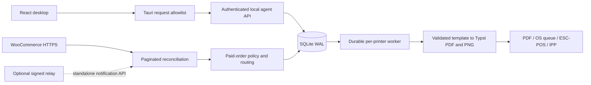

# Architecture

The desktop is a configuration/monitoring client. The agent owns synchronization, storage, rendering and hardware side effects. Both processes can run independently; GUI close hides its window and leaves the agent running.

The dashed relay edge is a planned integration: the standalone relay is implemented, but the agent does not currently consume its notifications. Polling is the active event path.

## Boundaries

| Package | Responsibility | Dependencies |
|---|---|---|
| domain | Geometry, typed records, eligibility helpers, condition AST, states | Serde, decimal, URL |
| security | OS credential vault, constant-time tokens, webhook HMAC, private files | keyring, HMAC |
| persistence | SQLx repositories, migrations, transactions, attempts, backups | domain |
| woocommerce | HTTPS/auth, bounded responses, pagination | domain/security |
| template-core | Declarative validation, safe field lookup, built-ins, fictional samples | domain |
| document-rendering | Literal-safe compiler, packaged Typst process, PDF/PNG artifacts | template-core |
| printing-core | CUPS/macOS/Windows discovery/submission, TCP raster, IPP framing | domain |
| application | Composition, engine orchestration, authenticated API | preceding crates |
| agent | Exclusive lock, local endpoint, lifecycle/shutdown | application |
| relay | Signed notification storage and acknowledgment | persistence/security |
| desktop | Tauri window/tray/plugins and restricted IPC proxy | Tauri/Reqwest |

These cohesive crates implement the requested architectural boundaries without creating empty per-adapter crates. No core crate depends on the desktop. OS-specific adapters are conditionally compiled inside printing-core.

## Runtime decisions

SQLite uses foreign keys, WAL, a five-second busy timeout, four connections and migration tracking. One engine holds the data-directory lock. Synchronization and logical job creation commit together. A separate automatic-claim key prevents template/config changes from duplicating previously routed outputs.

At most four stores synchronize and four distinct printers process jobs concurrently. One job per printer is active. Failed rendering and known pre-submission transport errors use bounded exponential retry, up to five attempts. A transport error after side effects may have started produces `outcome_uncertain` and requires explicit reprint review.

The native bridge reads a private endpoint file and supplies its bearer token only from Rust. The development Vite bridge restricts host/origin/path/body size and injects the token server-side. API response cache control is no-store. Settings and configuration APIs are allowlisted.
